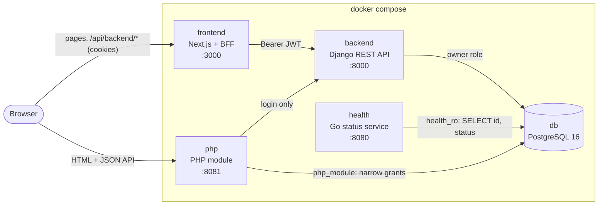

# Respina: Cloud Customer Panel

A web panel for managing cloud customers and their services: register customers, provision services
for them, and switch services between **active** and **suspended**. Staff see everything; a customer
sees only their own record. The interface is bilingual (English, and Persian with full RTL).

Four runnable components share one PostgreSQL database:

| Component | Stack | Role |
|---|---|---|
| `backend/` | Django 5.2, DRF, simplejwt (RS256) | Owns the schema and every business rule; issues JWTs |
| `frontend/` | Next.js 16, React 19, TanStack Query, shadcn/ui | The panel UI, plus a BFF that keeps tokens in httpOnly cookies |
| `health-service/` | Go (stdlib `net/http`, pgx) | Read-only status endpoint: `GET /health?service_id=125` |
| `php-module/` | PHP 8.3, PDO | Legacy-style module: view a customer, change a service's status |



## Prerequisites

- **Docker** with Compose v2, and **GNU Make**. That's all you need to run the stack. No Make
  (e.g. on Windows)? See [Without make](#without-make-eg-windows).
- `openssl` (for `make keys`) and `jq` (for `make smoke`).
- Optional, to work on a component outside Docker: Python 3.12 + [uv](https://docs.astral.sh/uv/),
  Node.js 22, Go 1.25+, PHP 8.3 + Composer. See [docs/DEVELOPMENT.md](docs/DEVELOPMENT.md).

## Quick start

```bash
make env keys up seed
```

| Step | What it does |
|---|---|
| `make env` | Copies `.env.example` to `.env` (never overwrites an existing one). **Change the `change-me-*` values** for anything beyond local use. |
| `make keys` | Generates the RS256 keypair into `secrets/` (gitignored; existing keys are kept). |
| `make up` | Builds the images and starts all five services, returning once every one is healthy. |
| `make seed` | Loads demo data: 30 customers with services and some status history. Safe to run again. |

**Seeded accounts** (passwords are whatever is in your `.env`):

| Account | Email | Password |
|---|---|---|
| Staff (also Django admin) | `SEED_ADMIN_EMAIL` | `SEED_ADMIN_PASSWORD` |
| Customers | `customer1@example.com` … `customer3@example.com` | `SEED_CUSTOMER_PASSWORD` |

Stop with `make down` (keeps the database volume); `make help` lists every target.

### Without make (e.g. Windows)

The Makefile only wraps a few commands, so the stack runs without it. On Windows, use Docker
Desktop and run these from **Git Bash** (it ships with Git for Windows and includes `openssl`),
in the repository root:

```bash
# make env: create .env (skip if you already have one)
[ -f .env ] || cp .env.example .env

# make keys: RS256 keypair for JWT (skip if secrets/ already has both files)
mkdir -p secrets
openssl genpkey -algorithm RSA -pkeyopt rsa_keygen_bits:2048 -out secrets/jwt_private.pem
openssl pkey -in secrets/jwt_private.pem -pubout -out secrets/jwt_public.pem

# make up: build and start, return when every service is healthy
docker compose up -d --build --wait --wait-timeout 180

# make seed: demo data
docker compose --profile seed run --rm seed
```

Stop with `docker compose down`. Shell scripts are pinned to LF line endings in `.gitattributes`,
so a Windows checkout runs the same as on Linux or macOS.

## Service URLs

| What | URL |
|---|---|
| Panel (frontend) | http://localhost:3000 |
| API docs (Swagger UI) | http://localhost:8000/api/docs/ |
| OpenAPI schema | http://localhost:8000/api/schema/ |
| Django admin | http://localhost:8000/admin/ |
| Status service | http://localhost:8080/health?service_id=125 |
| PHP module | http://localhost:8081 |

PostgreSQL is published on `127.0.0.1:5432` only, for local tools and tests (`make psql` opens a shell).

## Tests

```bash
make test    # every component's unit and integration suite
make lint    # ruff, ESLint + lint:rtl + tsc, gofmt + go vet, phpstan
make smoke   # cross-service check against the running stack (needs `make up seed`)
```

Per component:

| Component | Command | Notes |
|---|---|---|
| backend | `cd backend && uv run pytest` | Needs the compose database (`docker compose up -d db`) |
| frontend | `cd frontend && npm test` | Vitest + msw; `npm run e2e` for Playwright (see below) |
| health-service | `cd health-service && go test -race ./...` | DB integration test runs when `HEALTH_TEST_DATABASE_URL` is set |
| php-module | `cd php-module && vendor/bin/phpunit` | DB integration tests run when `PHP_TEST_DB_DSN` is set |

`make smoke` (`scripts/smoke.sh`) logs in, creates a customer and a service, suspends it through
Django, checks the Go service sees it, reactivates it through PHP, checks the audit trail, and
checks that a customer token can't see another customer in either Django or PHP.

Frontend end-to-end tests: `npm run e2e` runs the visual RTL baselines and the table-fit sweep
(fixture data, no backend). The full login → status-change smoke needs the stack and staff
credentials: `E2E_EMAIL=… E2E_PASSWORD=… npm run e2e`.

## Repository layout

```
.
├── backend/            Django API: accounts, customers, cloud (services, transitions, audit)
├── frontend/           Next.js panel + BFF (src/app/api/*), messages/{en,fa}.json, e2e/
├── health-service/     Go status service (cmd/, internal/{config,store,httpapi})
├── php-module/         PHP module (public/index.php, src/, templates/, bin/sql-guard.sh)
├── docker/postgres/    init script that creates the least-privilege roles
├── docs/               architecture, API, ERD, decisions, contributing, development
├── scripts/smoke.sh    cross-service smoke test
├── secrets/            JWT keypair from `make keys` (gitignored)
├── docker-compose.yml  the full stack
└── Makefile            env, keys, up, seed, test, lint, smoke, …
```

Each component has its own README with details: [backend](backend/README.md),
[frontend](frontend/README.md), [health-service](health-service/README.md),
[php-module](php-module/README.md).

## Security overview

- **Secrets** live in `.env` and `secrets/`, both gitignored; CI scans the git history with gitleaks.
  Compose passes each service only the variables it reads, so the frontend never sees a database
  password. JWT keys are compose secrets: only the backend gets the private key; PHP gets the
  public key alone, so it can verify tokens but never mint them.
- **JWTs** are RS256 with a 15-minute access token and single-use refresh tokens (rotated and
  blacklisted). In the browser, tokens live in httpOnly `SameSite=Lax` cookies set by the Next.js
  BFF; JavaScript never sees them, and mutating BFF calls require `X-Requested-With: fetch`.
- **Database roles**: Django uses the owner role. The Go service connects as `health_ro`, which can
  read only `services(id, status)`. The PHP module connects as `php_module`, which can read
  customers and services, update a service's status, and insert audit rows, and nothing else.
  CHECK constraints reject invalid states whichever program writes.
- **Authorization** is enforced by query scoping: another customer's records answer **404**, not
  403, so IDs can't be probed.

## Documentation

| Document | Contents |
|---|---|
| [docs/ARCHITECTURE.md](docs/ARCHITECTURE.md) | Components, request flows, key decisions |
| [docs/API.md](docs/API.md) | Authentication, every endpoint with curl, error codes |
| [docs/ERD.md](docs/ERD.md) | The four tables, their relationships and delete rules |
| [docs/DECISIONS.md](docs/DECISIONS.md) | Architecture decision records (ADR-001 … ADR-012) |
| [docs/CONTRIBUTING.md](docs/CONTRIBUTING.md) | Branching, commits, PR checklist, extension recipes |
| [docs/DEVELOPMENT.md](docs/DEVELOPMENT.md) | Running without Docker, debugging, tooling |
| [docs/IMPLEMENTATION_PLAN.md](docs/IMPLEMENTATION_PLAN.md) | The phase-by-phase plan this was built from |
