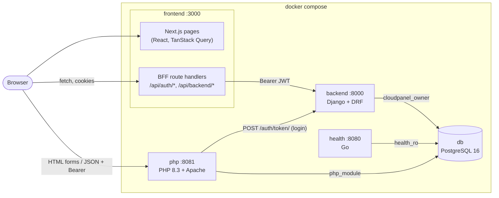
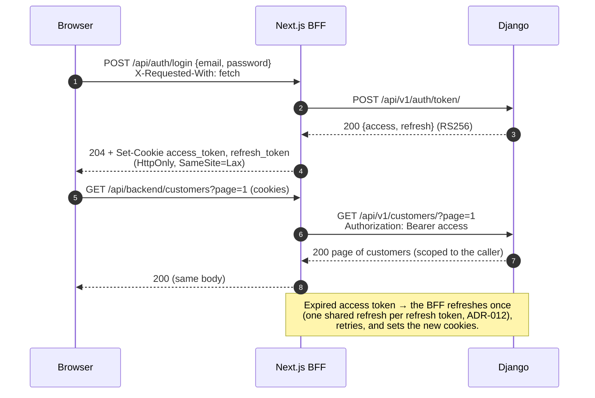
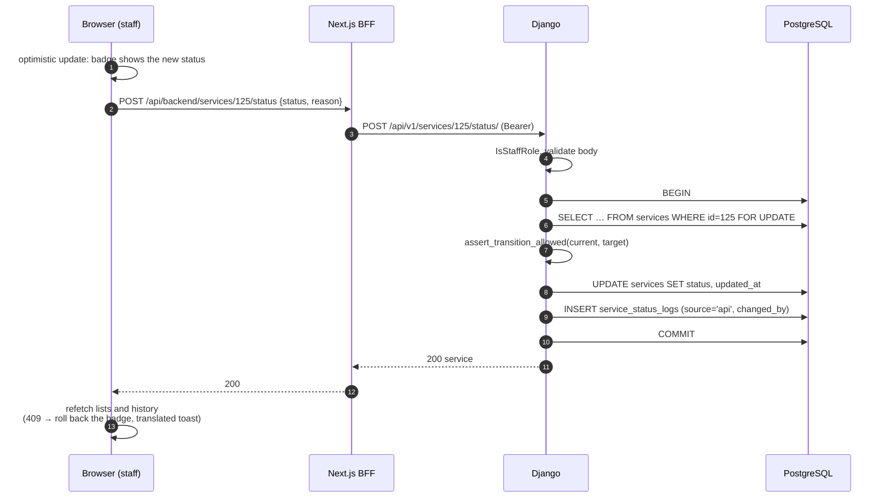
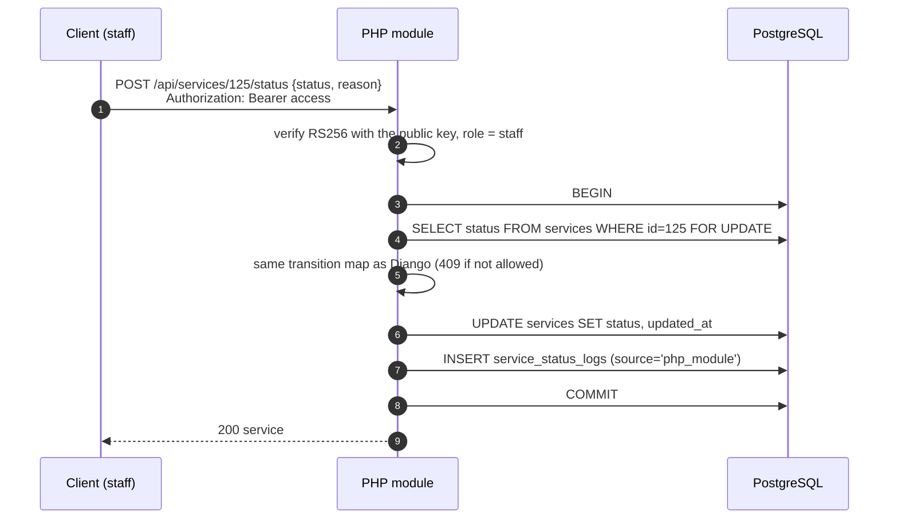

# Architecture

## Components

| Component | Owns | Talks to |
|---|---|---|
| **backend** | The schema and migrations, every business rule (state machine, scoping, validation), token issuing | PostgreSQL as the owner role |
| **frontend** | The UI and the **BFF**: the only code that touches tokens, which it keeps in httpOnly cookies | Django only, server-side |
| **health** | A read-only status probe for one service | PostgreSQL as `health_ro`: `SELECT (id, status) ON services` |
| **php** | A legacy-style page and JSON API for viewing a customer and changing a service's status | PostgreSQL as `php_module`; Django only to log in |

All four return the same error envelope (`{error: {code, message, details, request_id}}`) and pass
an `X-Request-ID` through, so one id follows a request across components and logs.

## Request flows

### Login through the BFF

The browser never sees a JWT. The BFF exchanges credentials for tokens and stores them in httpOnly
cookies; later requests carry the cookies, and the BFF turns them into a `Bearer` header.

The proxy (`frontend/src/proxy.ts`) only checks that a session cookie exists, as a UX redirect to
`/login`. Django authorizes every request. The BFF forwards only paths under `/api/v1/` and rejects
mutating calls without `X-Requested-With: fetch` (CSRF).

### Status change through Django

### Status change through the PHP module

The PHP module verifies the same JWT with the **public** key and writes directly to the database
as `php_module`, inside one transaction, following the same rules as Django
([ADR-006](DECISIONS.md#adr-006-the-php-module-writes-to-the-database-directly)).

The HTML pages use the same path with a session instead of a header: the login form posts to
Django's token endpoint, the session keeps the access token, and every form carries a CSRF token.

### Status lookup through the Go service

`GET /health?service_id=125` validates the id, runs one parameterized `SELECT status FROM services
WHERE id = $1` as `health_ro`, and answers `200 {status, service_id, service_status}`, `404`, or
`503 dependency_unavailable` if the database is down.

## Key decisions

Full records in [DECISIONS.md](DECISIONS.md).

| ADR | Decision | In one line |
|---|---|---|
| 001 | Monorepo | One repo, one compose file, one CI; each component keeps its own toolchain. |
| 002 | Django owns the schema | One place for migrations; Go and PHP read a stable, explicitly named schema. |
| 003 | Next.js with a BFF | Tokens stay server-side in httpOnly cookies; the browser can't leak them. |
| 004 | RS256 JWTs | Only Django can sign; PHP verifies with the public key. |
| 005 | CHECK constraints + least-privilege roles | The database rejects invalid states and limits what each program can do. |
| 006 | PHP writes directly | Matches how the existing PHP products work, behind a role that can only change status and log it. |
| 007 | Tailwind v4 + shadcn/ui + Obsidian shell | Owned components, one design language, RTL-ready. |
| 008 | English + Persian (RTL) | Locale in a cookie, logical CSS properties only (`lint:rtl`). |
| 009 | No global client store | Server state in TanStack Query, UI state in the URL. |
| 010 | `main` ← `dev` ← `phase/*` | Phases merge into `dev` with `--no-ff`; `main` takes releases only. |
| 011 | Cache Components off | Every page is per-user and the layout reads the locale cookie. |
| 012 | Single-use refresh tokens | Rotation + blacklist in Django; one shared refresh per token in the BFF. |

## Data model and relationships

<!-- maintainer -->
All four components use a single PostgreSQL database, rather than separate databases. This is what allows the service row to be locked (`FOR UPDATE`), and the status change and its audit row to commit in the same transaction, whether the change is from Django or from PHP. Splitting the data would make that cross-service coordination (an outbox or a saga) with no gain at this size. That also means foreign keys, `ON DELETE` rules and CHECK constraints apply to every writer, not just the one that happens to use an ORM.

The cost is coupling through the schema: the schema is a contract between four programs and a column renamed in a Django migration breaks Go and PHP without a compile error anywhere. Two rules bound that cost. Django owns migrations exclusively ([ADR-002](DECISIONS.md#adr-002-postgresql-django-owns-the-schema-and-migrations)) so schema changes are in one place and in review. Each program connects as a least-privilege role and the database itself rejects invalid values ([ADR-005](DECISIONS.md#adr-005-db-level-check-constraints-and-least-privilege-roles)): `health_ro` can only read `services(id, status)` and `php_module` can only change `status`/`updated_at` and append logs. A bug in either can at worst do just that, not corrupt the rest (`php_module` can still read every customer, so scoping it is the application's job; see below). The rest of the cost is shared fate. The database is a single point of failure, which is why every component returns `503 dependency_unavailable` instead of guessing.

## Scaling to 100k+ customers

<!-- maintainer -->
The writes don't grow first, but the customer list and search are the first queries to grow:

- **Search** does `icontains` on four columns (`first_name`, `last_name`, `email`, `phone`), which becomes `ILIKE '%term%'`. A leading wildcard cannot use a B-tree index, so all searches are a sequential scan of `customers`.
- **Pagination** runs `COUNT(*)` on each page, and Postgres has to count the matching rows each time. Deep pages add `OFFSET n` to skip (read and discard) the first n rows.

I'd add, in order, cheapest first, and only after measuring:

1. **Measure.** Enable `pg_stat_statements` to find out which queries are taking the most total time, and then `EXPLAIN (ANALYZE, BUFFERS)` the worst ones.
2. **Trigram indexes.** `pg_trgm` with GIN indexes on the four search columns means `ILIKE '%…%'` will use an index without any change to Django code.
3. **Cheaper pagination.** Keyset (cursor) pagination for deep pages, leveraging the existing `customers(created_at)` index (with `id` as a tiebreaker), and an estimated or capped count instead of an exact `COUNT(*)`.
4. **Connection pooling.** PgBouncer in front of Postgres. Today each Django worker has a connection for up to 60s (`CONN_MAX_AGE`) and Go and PHP have theirs; more workers hit `max_connections` before they hit CPU.
5. **A read replica for the Go service.** It only reads (`health_ro` can't write) and a second old status is acceptable for a health probe, so it is the safest load to move off the primary. Django and PHP stay on the primary because they need to read their own writes.

## Tenant data isolation

<!-- maintainer -->
Now, the isolation is imposed in the application code. Django scopes each query in `get_queryset` (`visible_customers_for`, `visible_services_for`), so another customer's record is a 404, not a 403, and its existence doesn't leak. PHP scopes in SQL with `(:is_staff OR s.customer_id = :own_customer_id)`. Both have tests.

That's one layer. If a new endpoint or new PHP query forgets the filter, the database would return rows from all tenants, and there is nothing to stop it. PHP is the bigger risk because it doesn't go through Django's query sets at all. The Go `/health?service_id=` endpoint is unauthenticated and returns the status of any service by id. That is fine as long as it remains an internal probe returning nothing but the status.

I think application scoping and tests is enough for now. The next step would be Postgres row-level security as a second layer, starting with the `php_module` role: a policy like `customer_id = current_setting('app.customer_id')::int`, set per transaction with `SET LOCAL`.
That has real costs: the value has to be set inside every transaction (which matters once
PgBouncer runs in transaction mode), the owning role bypasses RLS unless it is forced, and staff
need an explicit bypass policy. That's why it isn't there yet.

## Diagnosing slow API requests

<!-- maintainer -->
My first steps:

1. **Get the `request_id`** from response header `X-Request-ID` or error envelope.
2. **Trace it through the logs** of the BFF, Django, PHP or Go. Django and Go write one `"request"` line per request with `duration_ms`, so the slow component usually shows directly. All components log the same id.
3. **Django? Count the queries.** N+1 is probably the culprit. The `CaptureQueriesContext` tests protect the list endpoints, but only the paths they cover.
4. **`EXPLAIN (ANALYZE, BUFFERS)` the slow query.** Look for a sequential scan where you expected an index, or a large gap between estimated and actual rows. Compare to the indexes in [ERD.md](ERD.md).
5. **Check `pg_stat_statements`** to see if it's one slow request or a query that is slow all the time.

What’s missing today:

- Only Django and Go log a per-request `duration_ms`. The BFF logs no timings and PHP logs only errors, so a slow hop through either is found by comparing timestamps.
- **No tracing** (e.g. OpenTelemetry) so one request's time can't be split across BFF -> Django -> Postgres without reading timestamps by hand.
- **No metrics endpoint** (e.g. Prometheus `/metrics`), so you don't get p95 latency per endpoint, no alert before a user reports the problem.
