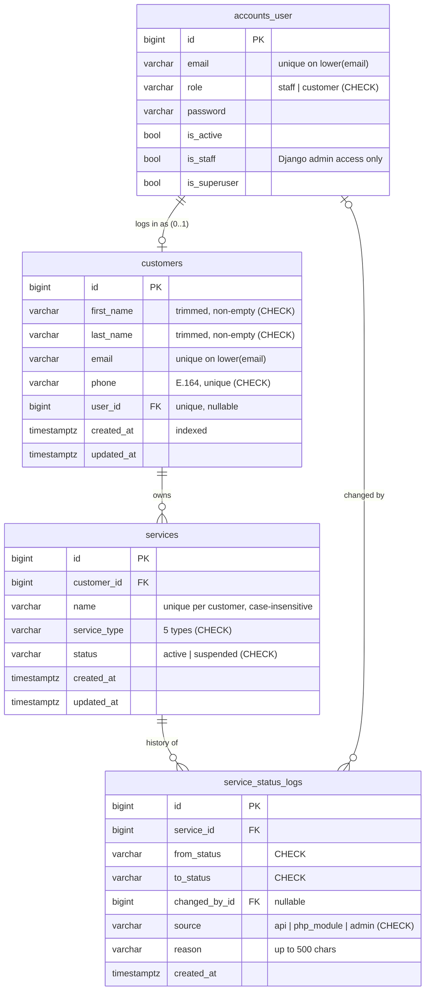

# Entity–relationship diagram

Django owns the schema and all migrations ([ADR-002](DECISIONS.md#adr-002-postgresql-django-owns-the-schema-and-migrations)).
Tables have explicit names so the Go service and the PHP module can query them directly.

## Relationships

| Relationship | Cardinality | How it's enforced |
|---|---|---|
| user → customer | 1 ↔ 0..1 | `customers.user_id` is a **unique**, nullable FK. A staff user has no customer row; a customer may exist without a login (staff create customers before giving them access). |
| customer → services | 1 ↔ N | `services.customer_id`, not null. Names are unique per customer, ignoring case: `UNIQUE (customer_id, lower(name))`. |
| service → status logs | 1 ↔ N | `service_status_logs.service_id`, not null. Every status change writes exactly one row in the same transaction, with the service row locked. |
| user → status logs | 0..1 ↔ N | `service_status_logs.changed_by_id`, nullable: who made the change, when known. |

Indexes beyond the primary keys: `customers(created_at)`, `services(customer_id, created_at DESC)`,
`services(status)`, `service_status_logs(service_id, created_at DESC)`. They match the list
queries: newest first, per customer or per service, and filtering by status.

## Delete behaviour

The `ON DELETE` rules are set **in the database**, not only in Django's ORM (migration
`cloud/0003`). The PHP module and anyone with `psql` bypass Django, so the database has to enforce
them itself.

| Foreign key | Rule | Why |
|---|---|---|
| `services.customer_id` | **PROTECT** (`RESTRICT`) | Deleting a customer who still has services would silently delete billable infrastructure and its audit trail. The services have to be removed (or moved) deliberately first. |
| `service_status_logs.service_id` | **CASCADE** | A log row describes one service and means nothing without it. Once a service is deliberately deleted, its history goes with it. |
| `customers.user_id` | **SET NULL** | Removing a login (e.g. an employee leaves, or a customer's access is revoked) must not delete the customer record or its services. The customer simply has no login. |
| `service_status_logs.changed_by_id` | **SET NULL** | The audit trail must survive the deletion of the user who made the change. The row keeps what happened, when, and through which `source`; only the actor link is lost. |

## Constraints that matter to other components

Several programs write to this database, so invalid states are rejected by **CHECK constraints**,
not only by Django validators ([ADR-005](DECISIONS.md#adr-005-db-level-check-constraints-and-least-privilege-roles)):

- `services.status` and both `service_status_logs` status columns: `active` or `suspended`.
- `services.service_type`: one of the five types.
- `service_status_logs.source`: `api`, `php_module` or `admin`.
- `customers.phone`: E.164 (`^\+[1-9][0-9]{6,14}$`); names trimmed and non-empty.

The least-privilege roles see only part of this schema:

| Role | Can do |
|---|---|
| `health_ro` | `SELECT (id, status)` on `services` |
| `php_module` | `SELECT` on `customers` and `services`; `UPDATE (status, updated_at)` on `services`; `INSERT` on `service_status_logs` (+ `USAGE` on its id sequence) |
